# Manual de usuario de SENTRIA (versión `6d8c6b5`)

Para quien revisa alertas (rol de analista) y para quien solo consulta (rol de invitado). Las tareas del administrador están en el manual de administración. Para escribirlo no se ejecutó nada. Las marcas:
- **[C]**: comprobado;
- **[D]**: documentado, no comprobado: sin ejecución registrada, y no se ejecutó para escribir este manual;
- **[F]**: falta un dato.

Las evidencias de las marcas [C] son registros del laboratorio que no se publican en el repositorio.

**Sobre las capturas:**
- **U-1 a U-6** son capturas de la versión final, con datos del laboratorio. U-2 y U-3 van en una **copia pública**, sin nombres de cuentas, correo ni barra del navegador. U-4 va en una copia pública que omite la descripción de uso del equipo PC-01.
- **VP-1 a VP-5** son de la vista previa del frontend del 11 oct 2026, con **datos sintéticos**, no con alertas reales. Pueden diferir en detalles menores de la versión entregada. Se usan para pantallas sin captura real. Que una pantalla funcione en la vista previa (SQLite temporal, sin Wazuh, MySQL ni modelos) no equivale a haber ejecutado ese flujo contra el sistema real.
- **U-6** es una captura real del laboratorio: el menú de acciones sobre las alertas de la prueba FIM-PC01-1 en el computador de escritorio, sin datos personales.

## 1. Qué hace SENTRIA por usted

SENTRIA trae alertas de Wazuh y, si cumplen la política (nivel 7 o superior, un equipo con perfil y que no correspondan a ruido operativo excluido), le pide a un modelo de lenguaje una primera interpretación:
- un veredicto: requiere atención o falso positivo;
- un nivel de riesgo;
- campos inspirados en CVSS;
- una explicación.

Antes de mostrarla, comprueba que la respuesta tenga el formato esperado y que sus factores estén sustentados en la alerta. Si no supera esas comprobaciones, la alerta queda como análisis fallido, sin veredicto.

Usted puede confirmar o corregir la clasificación; la revisión no es obligatoria. **SENTRIA no descarta alertas por su cuenta:** todas las alertas registradas en SENTRIA siguen visibles en alguna cola. Las que el comando de ingesta encuentra y la política no admite solo se cuentan: no se registran, así que no aparecen en ninguna cola. La acción web «Actualizar» sí las registra como omitidas.

## 2. Iniciar sesión

Abra la dirección que le dé el administrador y entre con su usuario y contraseña (**U-1**). La sesión se cierra con **Salir**, al pie del menú lateral. **[C]**

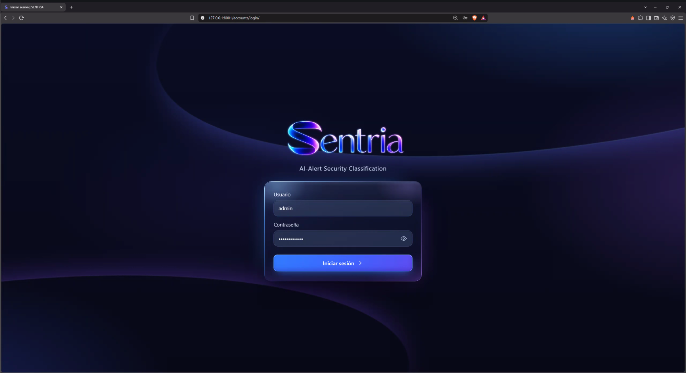

Lo que ve depende de su rol:
- con el de **invitado** puede consultar las colas, el detalle y las ventanas de mantenimiento, pero no ve los botones que modifican datos (**VP-5**);
- con el de **analista** además puede actualizar, revisar, reintentar, exportar, ver métricas y declarar ventanas.

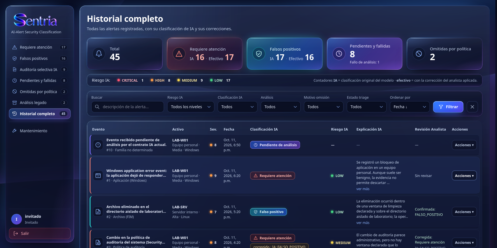

## 3. La pantalla principal y las colas

La pantalla principal (**U-4**) tiene:
- tarjetas con el total y el número de alertas por estado;
- una franja con el reparto por riesgo;
- filtros;
- la tabla de alertas.

El menú lateral agrupa las alertas en colas. El número junto a cada una es su cantidad.

| Cola | Qué contiene |
|---|---|
| Requiere atención | Alertas que el modelo, o la corrección de una persona, marcó para atender. Es la cola de trabajo principal |
| Falsos positivos | Alertas clasificadas como falso positivo. No se borran |
| Auditoría selectiva IA | Falsos positivos del modelo que conviene que alguien mire: nivel 10 o más en Wazuh, riesgo alto o crítico, o una muestra estable del 10 % |
| Pendientes y fallidas | Sin analizar todavía, o con un análisis que no superó las comprobaciones |
| Omitidas por política | Alertas que no se enviaron al modelo (nivel menor que 7, equipo sin perfil o ruido operativo excluido), con el motivo |
| Análisis legado | Alertas analizadas con versiones anteriores de SENTRIA |
| Historial completo | Todas, con filtros |

**[C]** colas y contadores, en el laboratorio (**U-4**) y en la vista previa (**VP-5**).

**Actualizar** (analista o administrador) trae del indexador la alerta más reciente y la procesa: hace como máximo una consulta al modelo cada vez que se pulsa. **[C]**

## 4. Filtrar y buscar

Sobre la tabla hay una búsqueda por texto y filtros por riesgo, clasificación, estado del análisis, motivo de omisión y estado de revisión, además del orden (**U-5**). **Filtrar** aplica los filtros y la **X** los quita. **[C]**

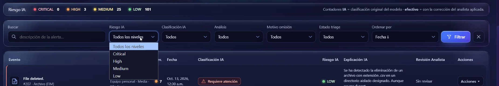

**Exportar CSV** (analista o administrador) descarga las alertas que se ven con los filtros activos. **[D] Documentada, no comprobada:** sale del código; no consta su uso en el laboratorio.

## 5. Ver el detalle de una alerta

Al pulsar una fila se abre el panel de detalle a la derecha (**U-4**). Se puede ampliar y cerrar con la X o con Escape. Muestra:
- la descripción original de Wazuh, la regla, la severidad y la fecha;
- el contexto del equipo y, si la hay, la ventana de mantenimiento y si su alcance cubre la operación;
- la clasificación del modelo: veredicto, riesgo, campos CVSS y explicación;
- la entrada enmascarada que se envió al modelo y su respuesta original, que no se pueden modificar;
- la revisión de la persona, si ya existe.

**[C]**

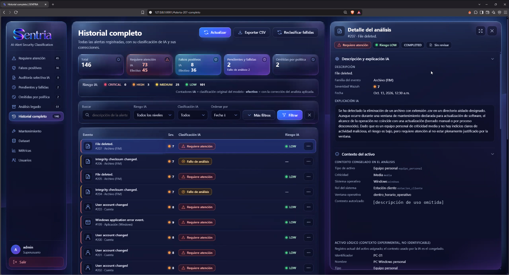

El enmascaramiento reduce los datos identificables que salen al proveedor, pero no garantiza el anonimato.

## 6. Revisar una alerta (opcional)

En el menú **Acciones ▾** de la fila (**U-6**):
- **Confirmar clasificación IA:** está de acuerdo con el veredicto (**VP-1**).
- **Corregir clasificación IA:** indica el veredicto correcto y, si quiere, el riesgo (**VP-2**). La clasificación original del modelo se conserva.
- **Excluir del dataset:** la evidencia no basta para decidir, y la alerta no se usa como ejemplo de ajuste.

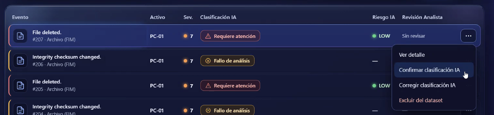

En todos los casos se elige el motivo:
- actividad autorizada;
- mantenimiento programado;
- comportamiento normal;
- evidencia de amenaza;
- contexto insuficiente;
- otro.

Si quiere, añade una nota. La decisión queda registrada aparte de la respuesta del modelo y es la que usan las métricas.

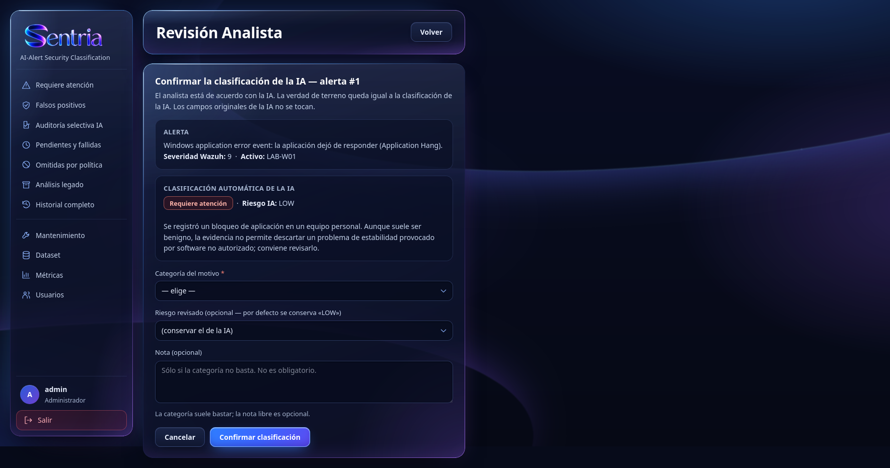

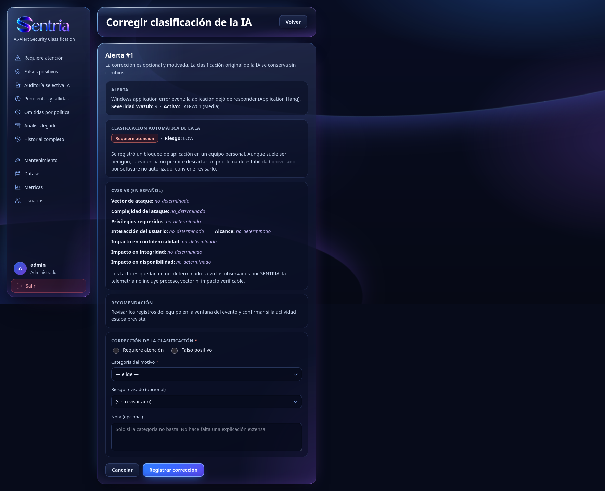

**Excluir del dataset** solo aparece cuando el análisis se completó y la alerta no está aprobada como ejemplo de ajuste. Registra una revisión «excluida»: la alerta queda sin etiqueta de referencia, así que no cuenta en las métricas, y su candidato a ejemplo pasa a excluido. **No modifica ningún ajuste ya ejecutado:** el modelo ajustado el 7 oct no cambia ni se reentrena. **[D]** (`dashboard/revision.py`, `dashboard/dataset.py`)

Estado: **[C]** las pantallas, en la vista previa (24/24 interacciones automáticas, 11 oct), que no equivale al flujo real. En el laboratorio, las revisiones de las sesiones de prueba se registraron con scripts que llaman a las mismas funciones de la aplicación, a partir de propuestas preparadas con apoyo de IA. [F] no se recalculó cuántas revisiones se hicieron por la pantalla.

**Reintentar análisis** (**VP-3**) solo está disponible para una alerta con análisis fallido que no sea de una prueba controlada. Trae de nuevo la evidencia de Wazuh, **vuelve a aplicar la política** y, si la alerta sigue siendo elegible, hace un solo intento con el modelo. No garantiza una llamada nueva: si la política ya no la admite, la alerta queda omitida sin consultar al modelo. Si el intento falla, sigue en análisis fallido; no hay reintentos automáticos. **[D] Documentada, no comprobada:** sale del código (`views.reintentar_analisis`, `ia/ingesta.reanalizar_alerta`); no consta su uso en el laboratorio, y solo la pantalla se vio en la vista previa.

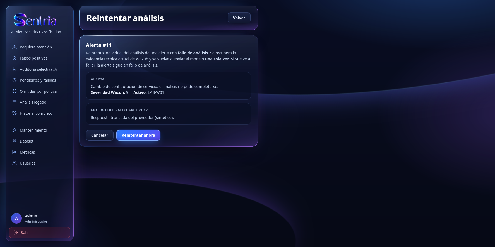

## 7. Ventanas de mantenimiento

Una ventana le avisa a SENTRIA de que un trabajo en un equipo estaba autorizado. Para declararla, en **Mantenimiento** (**VP-4**):
1. Elija el activo.
2. Indique el inicio y el fin en la hora local del activo.
3. Elija la categoría y el alcance de la operación.
4. Si quiere, escriba una descripción breve, que no se envía al modelo.

Las alertas de ese equipo dentro de la ventana llegan al modelo con ese dato y con si la operación coincide con el alcance. Una ventana se puede cancelar, pero no se borra. **[D]** la pantalla. En el laboratorio, las ventanas de las pruebas se crearon con un script **[C]**.

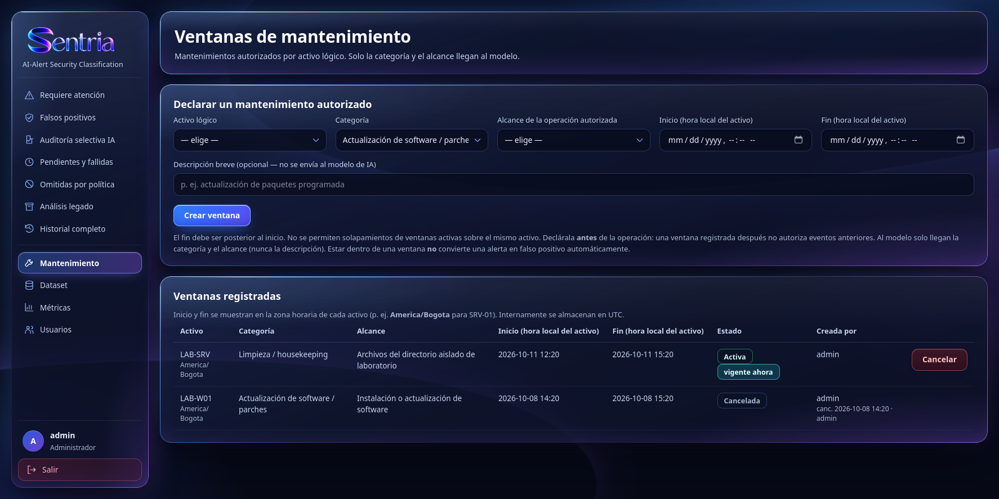

## 8. Métricas

La página **Métricas** compara la clasificación del modelo con las revisiones de las personas:
- la matriz de confusión;
- las tasas de falsos positivos y falsos negativos;
- la precisión, la sensibilidad y la exactitud.

Cada cifra va con el número de alertas con que se calculó, y la página avisa cuando hay menos de 30 revisiones: con tan pocas, las cifras son preliminares. Las etiquetas de pruebas controladas y las operativas se muestran por separado. **[C]**

Las métricas comparan la clasificación del modelo con las etiquetas disponibles, es decir, con lo que registraron las personas que revisaron. No demuestran que el sistema detecte amenazas: en el laboratorio no hubo ataques confirmados, y una etiqueta es tan buena como la revisión que la produjo.

## 9. Usuarios (solo administrador)

Se resume aquí. El detalle está en el [manual de administración](MANUAL_ADMINISTRACION.md), sección 2.

En **Usuarios** se ven las cuentas, con su rol y su estado (**U-2**), y se crean, editan, desactivan o eliminan. La edición (**U-3**) permite cambiar los datos y el rol, y tiene **dos casillas de estado** **[D]** (código de `6d8c6b5`):
- **«Active»** es la de la cuenta de Django: desmarcada, la cuenta no puede iniciar sesión.
- **«Activo»**, junto al rol, es la del perfil de SENTRIA. Se guarda, pero en la versión entregada ninguna comprobación de acceso la usa: **desmarcarla no corta el acceso.**

Para desactivar a alguien hay que desmarcar «Active». Las pantallas se ven en las capturas del laboratorio **[C]**; el efecto de cada casilla sale del código, sin prueba registrada.

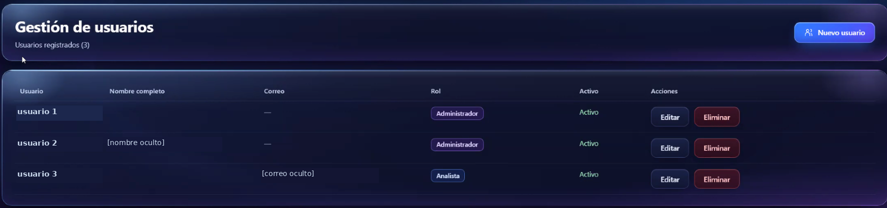

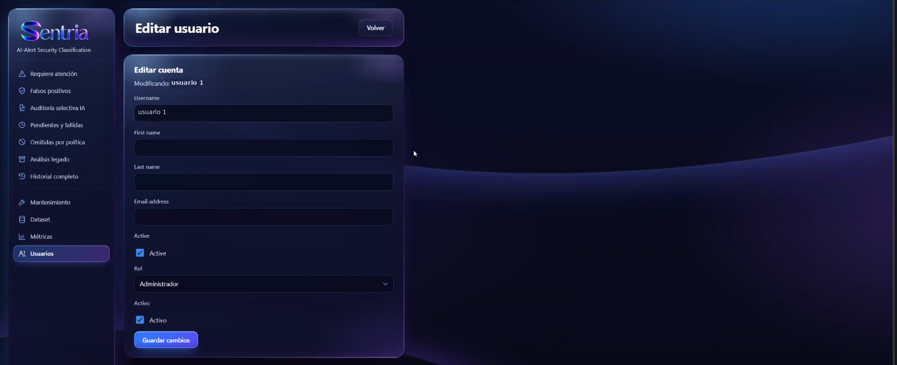

Las copias públicas de U-2 y U-3 ocultan los nombres de las cuentas, el nombre completo, el correo y la barra del navegador (con el identificador interno de la cuenta). La de U-2 está además recortada al panel de la tabla. Los originales no se publican.

## 10. Si algo no funciona

| Lo que ve | Qué significa | Qué hacer |
|---|---|---|
| Una alerta en «Pendientes y fallidas» con fallo | El modelo no respondió, se agotó la cuota o la respuesta no superó las comprobaciones | Reintentar más tarde o revisarla a mano. El detalle dice el motivo |
| Una alerta en «Omitidas por política» | Nivel menor que 7, equipo sin perfil o ruido operativo excluido (por defecto, alertas que traen a la vez los grupos `dpkg` y `config_changed`) | Si debería analizarse, pedir al administrador que asocie el equipo |
| «No se pudo consultar el indexador» al pulsar Actualizar | Wazuh no responde o su certificado cambió | Avisar al administrador |
| No ve un botón | Su rol no lo permite | Pedir el cambio al administrador |
